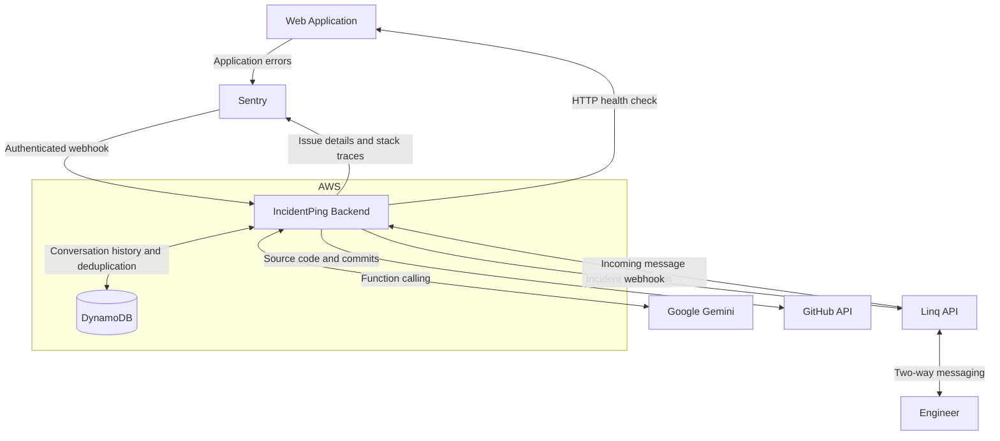

# IncidentPing

An AI-powered incident response assistant that brings
software incident investigation directly into your
messaging conversations.

Powered by Linq, IncidentPing automatically notifies
engineers about application errors and lets them
investigate incidents through natural language
without switching between multiple dashboards.

## Features

- Automatic incident alerts through Linq.
- Two-way conversational incident investigation.
- AI-powered root cause analysis using Google Gemini.
- Real-time Sentry issue and stack trace retrieval.
- GitHub source code and commit investigation.
- On-demand website health and response time checks.
- Persistent conversation memory using DynamoDB.
- Webhook authentication and conversation authorization.
- Atomic webhook deduplication across Lambda instances.
- Serverless deployment on AWS Lambda.

## Architecture



## How It Works

1. Sentry detects a new application error.
2. IncidentPing receives and authenticates the webhook.
3. DynamoDB atomically claims the incident to prevent
   duplicate notifications.
4. IncidentPing retrieves the issue details and sends
   an alert through Linq.
5. The engineer replies directly to the message.
6. Gemini selects the appropriate investigation tools.
7. IncidentPing retrieves evidence from Sentry, GitHub
   or the application's HTTP endpoint.
8. The investigation results are delivered through Linq.
9. Conversation history is persisted in DynamoDB.

## Example Conversation

Engineer:

> What caused PORTFOLIO-7, and which file is responsible?

IncidentPing:

> The incident originated in
> app/api/sentry-example-api/route.ts.
> The error was intentionally generated to simulate
> a database connection timeout.

Engineer:

> Is my website currently up?

IncidentPing:

> Your website returned HTTP 200 with a response
> time to receive headers of 269 milliseconds.

These examples are based on a controlled incident
simulation and a live website health check.

## Investigation Tools

| Tool                 | Purpose                                        |
| -------------------- | ---------------------------------------------- |
| list_issues          | Retrieve unresolved Sentry issues              |
| get_issue_details    | Retrieve details of a specific issue           |
| get_latest_event     | Retrieve exception and stack trace information |
| get_file_content     | Inspect relevant GitHub source code            |
| get_recent_commits   | Retrieve recent repository changes             |
| check_website_health | Check HTTP availability and response time      |

## Tech Stack

| Technology        | Purpose                            |
| ----------------- | ---------------------------------- |
| TypeScript        | Programming language               |
| NestJS            | Backend framework                  |
| Linq              | Two-way messaging                  |
| Google Gemini     | AI reasoning and function calling  |
| Sentry            | Application error monitoring       |
| GitHub API        | Source code investigation          |
| AWS Lambda        | Serverless compute                 |
| Amazon DynamoDB   | Persistent state and deduplication |
| Amazon CloudWatch | Application logs                   |

## Security and Reliability

- Linq webhook signature verification.
- Sentry HMAC signature verification.
- Additional Sentry webhook authentication token.
- Constant-time credential comparison.
- Authorized conversation filtering.
- Group chat filtering.
- Read-only GitHub investigation.
- Restricted repository and source file access.
- Basic sensitive information redaction.
- Atomic DynamoDB conditional writes for deduplication.
- Evidence retrieval checks for investigation responses.
- IAM-based DynamoDB access in AWS Lambda.
- Environment-based credential management.

## Getting Started

### Prerequisites

- Node.js 24
- npm
- Linq API credentials
- Google Gemini API credentials
- Sentry project and integration
- GitHub access token
- AWS account with DynamoDB access

### Installation

```bash
git clone <repository-url>
cd incidentping
npm ci
```

### Configuration

```bash
cp .env.example .env
```

Configure the environment variables using your own
credentials and integration settings.

Create a DynamoDB table with the following configuration:

| Setting       | Value        |
| ------------- | ------------ |
| Table name    | incidentping |
| Region        | us-east-2    |
| Partition key | pk (String)  |
| Sort key      | sk (String)  |
| TTL attribute | expiresAt    |
| Capacity mode | On-demand    |

For local development, configure AWS credentials through
the standard AWS credential provider chain.

Update the website URL in the health service to point
to your own application.

### Run Locally

```bash
npm run start:dev
```

### Build

```bash
npm run build
```

## API Endpoints

| Method | Endpoint        | Purpose                   |
| ------ | --------------- | ------------------------- |
| GET    | /               | Backend availability      |
| POST   | /webhook        | Incoming Linq messages    |
| POST   | /sentry/webhook | Incoming Sentry incidents |

## Deployment

IncidentPing is deployed on AWS Lambda using:

- Node.js 24 runtime
- Lambda Function URL
- 512 MB memory
- 60-second execution timeout
- IAM execution role
- Amazon DynamoDB
- Amazon CloudWatch

The Lambda entry point is `dist/lambda.handler`.

## Validation

The following workflows have been manually verified
against the deployed backend:

- Automatic incident notifications.
- Two-way conversational investigation.
- Sentry issue and stack trace retrieval.
- GitHub source code and commit retrieval.
- Live website health checks.
- Conversation persistence across Lambda cold starts.
- Authenticated Sentry webhook duplicate rejection.
- Authenticated Linq webhook duplicate rejection.
- Rejection of unsigned webhook requests.

## Current Limitations

IncidentPing V1 is a functional proof of concept,
not a production-ready incident management platform.

- Supports a single configured application and conversation.
- Retains the last 10 conversation exchanges for 30 days.
- Deduplication records expire after seven days.
- Concurrent messages may cause conversation history conflicts.
- Message delivery is not guaranteed to be exactly once.
- Health checks are on-demand rather than continuous.
- GitHub source retrieval uses a configured branch rather
  than the exact deployed commit.
- AI-generated conclusions require human verification.
- External API quotas and cloud usage costs may apply.

## Future Improvements

- Multi-project and multi-user support.
- Asynchronous incident processing.
- Deployment-aware source code investigation.
- Improved retry and delivery guarantees.
- Automated integration and concurrency tests.
- Incident escalation policies.

## Author

Built by **Nivedan B R**.

Master's student in Computer Science and Software
Engineering at the University of Washington.

- Portfolio: https://www.nivedan.website
- GitHub: https://github.com/Nivedan2004
